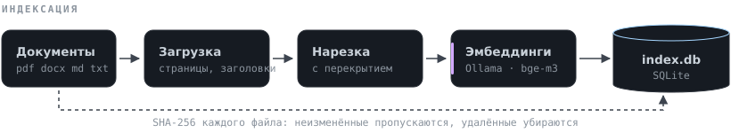
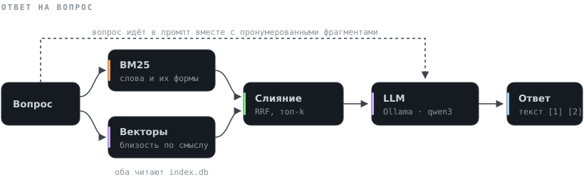
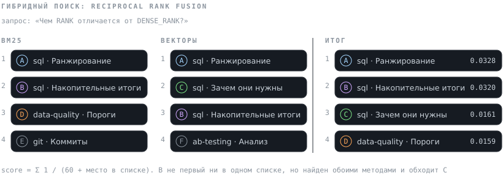

# Archivarius

[](https://github.com/Gregory-Bondarenko/archivarius/actions/workflows/ci.yml)

Поиск ответов по своим документам на своём компьютере. Программа индексирует папку с PDF, DOCX, Markdown и TXT, находит подходящие фрагменты и отвечает на вопрос через языковую модель в [Ollama](https://ollama.com). В каждом ответе есть ссылки на фрагменты, из которых он собран, так что любое утверждение можно проверить по источнику

Документы никуда не отправляются, внешние API и ключи не нужны

## Как устроено

<p align="center">
  
</p>

Каждый документ разбивается на фрагменты по границам абзацев и предложений, у фрагмента сохраняется место в исходнике: страница PDF или раздел по заголовкам. Тексты, векторы и служебные данные лежат в одном файле SQLite. При повторной индексации обрабатываются только новые, изменённые и удалённые файлы

<p align="center">
  
</p>

Вопрос ищется двумя способами сразу. BM25 находит фрагменты с теми же словами с учётом русских словоформ, векторный поиск находит близкие по смыслу формулировки. Списки сливаются, лучшие фрагменты нумеруются и вместе с вопросом уходят в модель с требованием отвечать только по ним и ставить ссылки

<p align="center">
  
</p>

Оценки BM25 и косинусная близость измеряются в разных шкалах, поэтому складываются не они, а места в списках. Фрагмент, который нашли оба метода, поднимается выше фрагмента, который один метод поставил высоко. Подробности решений: [docs/architecture.md](docs/architecture.md)

## Что понадобится

- Python 3.10 или новее
- [Ollama](https://ollama.com/download) и две модели: для эмбеддингов и для ответов
- видеокарта желательна, но не обязательна: без неё ответы идут заметно медленнее

Модель ответов подбирается под видеопамять. На 8 ГБ хватит `qwen3:4b-instruct`, на 12–16 ГБ подойдут `qwen3:8b` или `qwen3:14b`. Её можно менять в любой момент без переиндексации

Тег `qwen3:4b` в Ollama указывает на версию, которая рассуждает перед каждым ответом. Ответ она даёт в разы медленнее, особенно без видеокарты. Рассуждения в выдачу не попадают, но ждать их приходится. Для быстрых ответов берите `qwen3:4b-instruct`

## Установка

```bash
ollama pull bge-m3
ollama pull qwen3:8b

git clone https://github.com/Gregory-Bondarenko/archivarius.git
cd archivarius
python -m venv .venv
```

Активация окружения на Windows: `.venv\Scripts\activate`, на Linux и macOS: `source .venv/bin/activate`. Дальше одинаково:

```bash
pip install -e ".[dev]"
archivarius doctor
```

`doctor` проверяет, что Ollama запущена и обе модели скачаны

Если путь к папке содержит кириллицу, например `C:\Users\Наталья\...`, а Python младше 3.13, ставьте пакет без `-e`: `pip install ".[dev]"`. Такие версии читают служебный файл режима `-e` не в той кодировке, и команда `archivarius` не находит пакет. После правок кода установку в этом случае нужно повторять

## Запуск

```bash
archivarius index examples/corpus
archivarius ask "Чем RANK отличается от DENSE_RANK?"
archivarius serve
```

После `serve` веб-интерфейс открывается на http://127.0.0.1:8000. Рядом с ответом показаны найденные фрагменты и места, на которых их поставил каждый метод поиска. Процитированные фрагменты отмечены, остальные приглушены. Наведение на ссылку `[n]` подсвечивает источник, клик раскрывает фрагмент целиком

Индекс можно пополнять командой `index`, не останавливая сервер: изменения подхватятся при следующем вопросе

В `examples/corpus` лежит небольшая база знаний для проверки: Git, окружения Python, оконные функции SQL, A/B-тесты, Docker и контроль качества данных

## Команды

| Команда | Что делает |
|---|---|
| `index ПАПКА [--rebuild]` | индексирует документы, повторный запуск обрабатывает только изменения |
| `ask "вопрос" [-k 5] [-m hybrid]` | отвечает со ссылками на источники |
| `chat` | то же в диалоговом режиме |
| `search "запрос" [--json]` | показывает найденные фрагменты без генерации |
| `serve [--port 8000]` | веб-интерфейс и HTTP API, описание API на `/docs` |
| `eval НАБОР.jsonl [--report r.md]` | сравнивает режимы поиска по метрикам |
| `eval-generate ВЫХОД.jsonl [-n 30]` | генерирует набор вопросов по проиндексированным документам |
| `stats` | состояние индекса |
| `init` | создаёт `archivarius.yaml` с настройками по умолчанию |
| `doctor` | проверяет Ollama и модели |

Режим поиска `-m`: `bm25`, `dense` или `hybrid`, по умолчанию гибридный

## Оценка качества поиска

Режимы поиска сравнивались на корпусе из 54 статей русской Википедии по статистике и машинному обучению: распределения, статистические критерии, модели, нейросети. Темы нарочно близкие, с общей лексикой. К ним вручную написан 51 вопрос, и правильная статья для каждого известна заранее. Вопросы сформулированы своими словами, а не цитатами: «Какое распределение обладает свойством отсутствия памяти?», а не «экспоненциальное распределение»

| Режим | Hit@5 | Recall@5 | MRR@5 | nDCG@5 |
|---|---|---|---|---|
| по словам, BM25 | 0.941 | 0.922 | **0.826** | 0.840 |
| по смыслу, `bge-m3` | 0.941 | 0.931 | 0.769 | 0.805 |
| гибридный | **0.980** | **0.980** | 0.808 | **0.847** |

Hit@5 показывает долю вопросов, где нужная статья попала в первые пять, MRR показывает, насколько высоко она стоит. Что видно в разборе по вопросам:

- BM25 с русским стеммингом оказался сильнее векторов по точности первого места. В вопросах на определения термины часто совпадают с текстом статьи, а стемминг закрывает разницу в словоформах
- векторы находят статью, когда слова разные. На вопрос «какой метод выбирает параметры, при которых данные наиболее вероятны» BM25 не нашёл нужную статью вообще, а векторный поиск поставил метод максимального правдоподобия первым
- гибрид находит нужную статью чаще обоих методов: в 50 вопросах из 51 против 48. По MRR он немного уступает BM25, но на 51 вопросе это разница в 1–2 вопроса

Отдельно проверялись параметры слияния:

| Гибрид | Hit@5 | MRR@5 |
|---|---|---|
| `rrf_k = 60`, пул 30 | 0.941 | 0.800 |
| `rrf_k = 10`, пул 30 | 0.961 | 0.799 |
| `rrf_k = 60`, пул 10 | 0.980 | 0.808 |

С пулом 30 гибрид иногда опускал статью, которую один из методов уверенно ставил первой, ниже фрагментов со средних мест обоих списков. Пул 10 убирает этот шум, поэтому он выбран по умолчанию. На наборе такого размера это ориентир, а не строгий вывод

Как повторить (тексты статей распространяются по CC BY-SA 4.0, поэтому в репозитории лежат только список статей, вопросы и скрипт загрузки):

```bash
python scripts/fetch_wiki_corpus.py
ARCHIVARIUS_INDEX_PATH=.archivarius/wiki.db archivarius index data/wiki-stats
ARCHIVARIUS_INDEX_PATH=.archivarius/wiki.db archivarius eval examples/wiki/eval.jsonl -k 5
```

В PowerShell переменная задаётся отдельной строкой: `$env:ARCHIVARIUS_INDEX_PATH=".archivarius\wiki.db"`

Для своих документов набор вопросов можно составить вручную или сгенерировать моделью командой `eval-generate`, а потом просмотреть. Формат JSONL, правильный ответ задаётся на уровне документа, поэтому разметка не ломается при смене размера фрагментов:

```json
{"question": "Как отменить опубликованный коммит?", "relevant": ["git.md"]}
```

## Настройки

Параметры берутся из `archivarius.yaml` в текущей папке, шаблон с комментариями в [archivarius.example.yaml](archivarius.example.yaml). Любой параметр переопределяется переменной окружения `ARCHIVARIUS_<ИМЯ>`, например `ARCHIVARIUS_LLM_MODEL=gemma3:12b`

Модель эмбеддингов записывается в индекс. Если её сменить, индекс нужно пересобрать с `--rebuild`, иначе программа остановится с понятной ошибкой, а не смешает несовместимые векторы

## HTTP API

| Метод | Путь | Что делает |
|---|---|---|
| GET | `/api/search?q=...&k=5&mode=hybrid` | поиск фрагментов |
| POST | `/api/ask` | ответ на вопрос, с `"stream": true` поток NDJSON |
| GET | `/api/documents` | список проиндексированных документов |
| GET | `/api/stats` | состояние индекса |
| GET | `/api/health` | проверка работоспособности |

Поток ответа состоит из событий `sources`, затем `token` по мере генерации и `done` с номерами процитированных источников и замерами времени

## Структура

```
src/archivarius/
  config.py         настройки из YAML и переменных окружения
  loaders.py        чтение PDF, DOCX, Markdown, TXT
  chunking.py       нарезка на фрагменты с перекрытием
  text.py           токенизация и стемминг
  bm25.py           лексический поиск Okapi BM25
  store.py          индекс в SQLite
  indexer.py        инкрементальная индексация
  retrieval.py      BM25, векторный и гибридный поиск
  generation.py     промпт, ссылки, фильтрация рассуждений модели
  evaluation.py     метрики и синтетический набор вопросов
  models.py         интерфейсы моделей и их реализации для Ollama и тестов
  ollama_client.py  клиент REST API Ollama
  engine.py         связывает всё вместе
  cli.py api.py     командная строка и HTTP API
  web/index.html    веб-интерфейс
examples/           демонстрационные документы, корпус для оценки и вопросы к ним
docs/               архитектура и схемы
scripts/            загрузка корпуса для оценки и генерация схем
tests/              тесты
```

## Документация

| Документ | О чём |
|---|---|
| [docs/architecture.md](docs/architecture.md) | как устроены индекс, поиск и генерация, почему выбраны такие решения, ограничения |
| [CHANGELOG.md](CHANGELOG.md) | журнал изменений |

## Разработка

```bash
pytest -q
ruff check . && ruff format --check .
```

Тесты не требуют запущенной Ollama: вместо моделей подставляются детерминированный векторизатор и заглушка LLM, а HTTP-клиент проверяется на имитации API. CI гоняет тесты на Ubuntu и Windows для Python 3.10 и 3.12

## Лицензия

[MIT](LICENSE)
